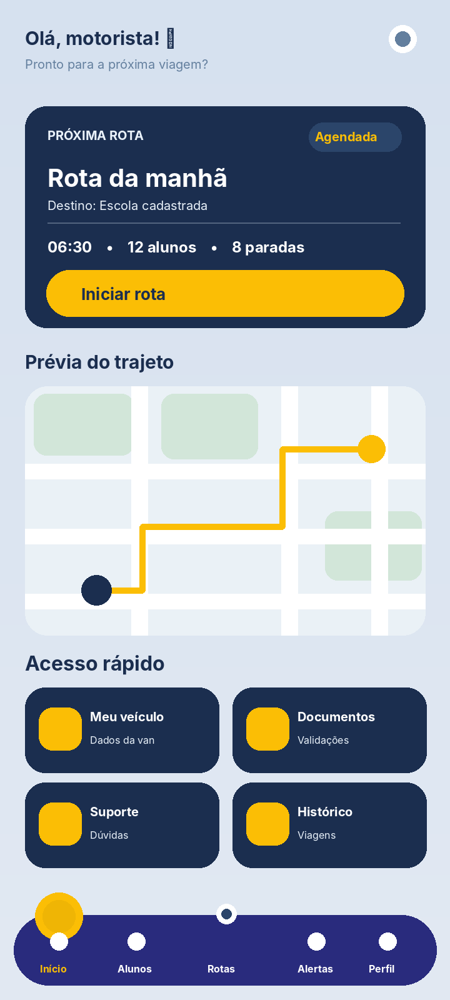
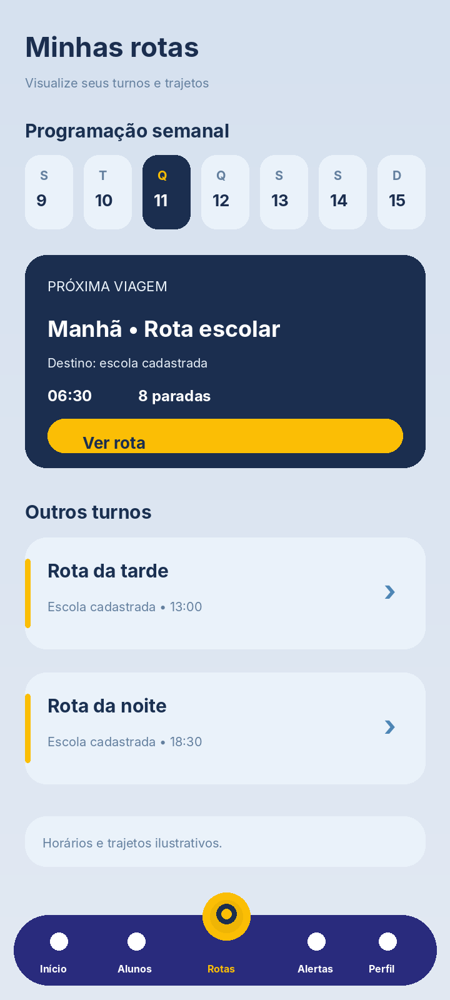
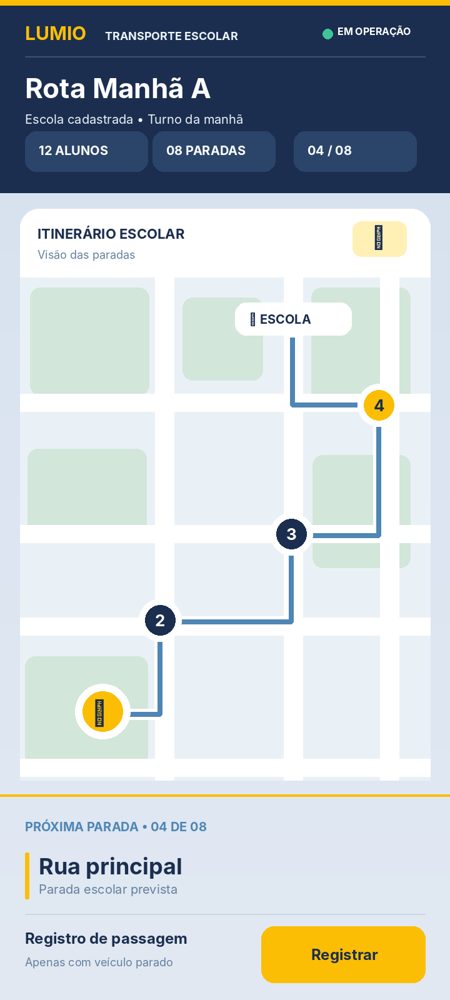
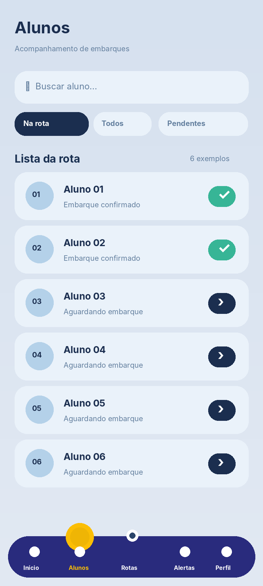
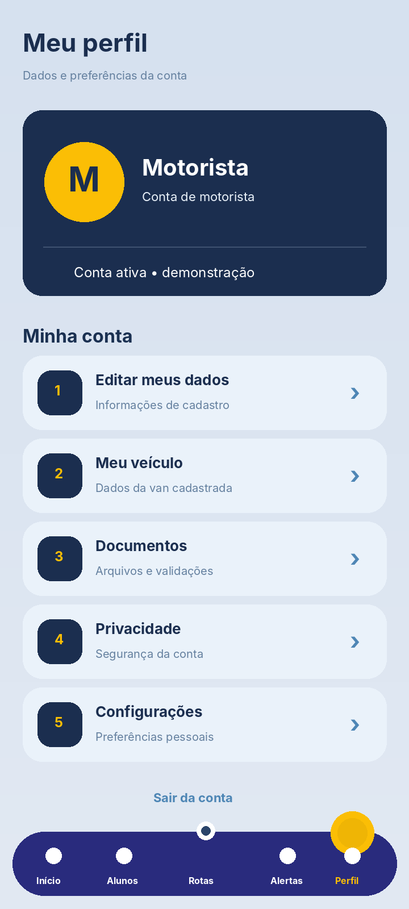

# Lumio — Avanços do Figma (11/11/2026)

> **Data dos avanços documentados:** 11/11/2026 (quarta-feira)  
> **Projeto:** Lumio — Projeto Integrador  
> **Destino:** branch `Igor` do repositório `TIPI02-PI/PI-GRUPO2`.

## Visão geral

Durante a sessão de design, a interface mobile do motorista foi refinada na página **Teste** do Figma, partindo da Home existente. O padrão visual foi mantido: tons de azul, destaque amarelo, tipografia de interface e navegação inferior nas telas gerais.

A interface de percurso recebeu atenção especial para reduzir distrações e abandonar a aparência de aplicativos de corridas. O conceito final usa um **itinerário escolar**, dados do turno, quantidade prevista de alunos, paradas numeradas e registro de passagem que pressupõe veículo parado.

As telas são **protótipos de design**. Não existe, apenas por esta entrega, conexão funcional com GPS, mapas, banco de dados ou confirmação real de embarques.

## Telas do motorista

| Tela | Link do frame no Figma | Mudança principal |
| --- | --- | --- |
| Home | [Abrir](https://www.figma.com/design/YklZ8NiIhgwh6Qd1facwef/Projeto-Integrador?node-id=176-736) | Próxima rota, prévia do mapa e acessos rápidos |
| Minhas rotas | [Abrir](https://www.figma.com/design/YklZ8NiIhgwh6Qd1facwef/Projeto-Integrador?node-id=184-25) | Turnos e rotas programadas |
| Rota escolar em operação | [Abrir](https://www.figma.com/design/YklZ8NiIhgwh6Qd1facwef/Projeto-Integrador?node-id=184-180) | Mapa de itinerário, paradas numeradas e registro discreto |
| Alunos | [Abrir](https://www.figma.com/design/YklZ8NiIhgwh6Qd1facwef/Projeto-Integrador?node-id=184-318) | Lista de embarque e estados dos alunos |
| Avisos e alertas | [Abrir](https://www.figma.com/design/YklZ8NiIhgwh6Qd1facwef/Projeto-Integrador?node-id=184-479) | Comunicados e atualizações |
| Perfil | [Abrir](https://www.figma.com/design/YklZ8NiIhgwh6Qd1facwef/Projeto-Integrador?node-id=184-620) | Informações e preferências do motorista |
| Meu veículo | [Abrir](https://www.figma.com/design/YklZ8NiIhgwh6Qd1facwef/Projeto-Integrador?node-id=184-772) | Identificação e dados da van |
| Documentos | [Abrir](https://www.figma.com/design/YklZ8NiIhgwh6Qd1facwef/Projeto-Integrador?node-id=184-902) | Arquivos e validações |
| Suporte | [Abrir](https://www.figma.com/design/YklZ8NiIhgwh6Qd1facwef/Projeto-Integrador?node-id=184-1045) | Dúvidas frequentes e solicitação de ajuda |
| Histórico | [Abrir](https://www.figma.com/design/YklZ8NiIhgwh6Qd1facwef/Projeto-Integrador?node-id=184-1187) | Registros de viagens anteriores |

## Prévia visual das principais interfaces

**Nota sobre as imagens:** as imagens desta pasta são **prévias ilustrativas recriadas a partir dos layouts revisados no Figma**, e não exportações oficiais dos frames. Consulte os links acima para a versão original e editável.

### Home do motorista



### Minhas rotas



### Painel de percurso escolar



### Alunos



### Perfil



## Telas administrativas (desktop)

Houve também organização da área administrativa do Lumio, com login, visão geral e seções de gestão de usuários, motoristas, documentos, denúncias, suporte e configurações.

- [Workspace da administração](https://www.figma.com/design/YklZ8NiIhgwh6Qd1facwef/Projeto-Integrador?node-id=168-14)
- [Visão geral administrativa](https://www.figma.com/design/YklZ8NiIhgwh6Qd1facwef/Projeto-Integrador?node-id=167-14)

## Próximos passos

- Validar com a equipe do projeto as funcionalidades previstas para cada perfil.
- Conferir o fluxo de alunos e de confirmação de embarques/desembarques.
- Criar ligações entre os frames no Prototype do Figma.
- Implementar os componentes mobile respeitando a estrutura do repositório.
- Integrar dados reais e localização somente após validação da arquitetura, autorização e testes de segurança.

## Como adicionar à branch Igor

Se o projeto já está clonado no computador:

```bash
git switch Igor
# Copie a pasta figma/ deste pacote para a raiz do repositório
git add figma/
git commit -m "docs(figma): registra evolução visual das telas do Lumio"
git push origin Igor
```

Esses comandos publicam **somente na branch Igor** e não alteram diretamente a `main`.
