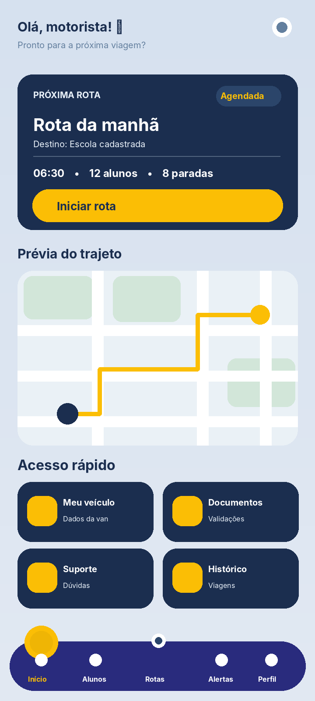
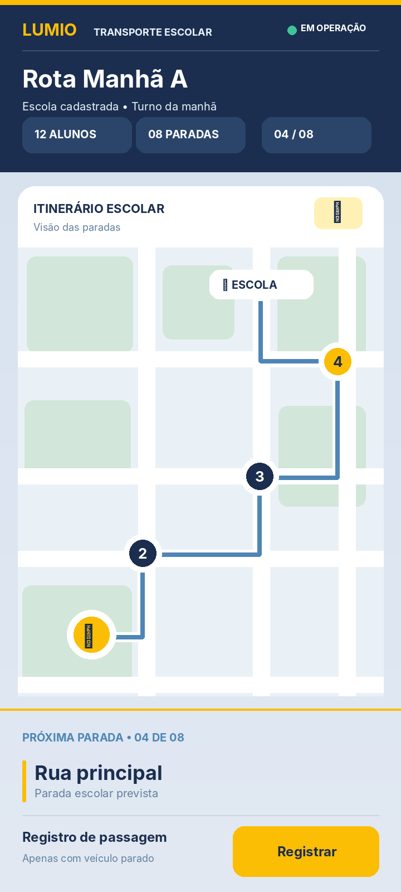
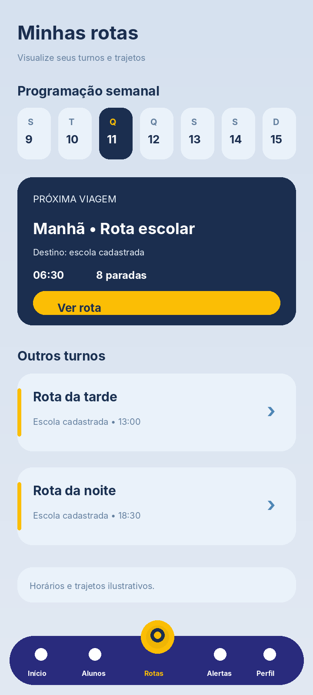
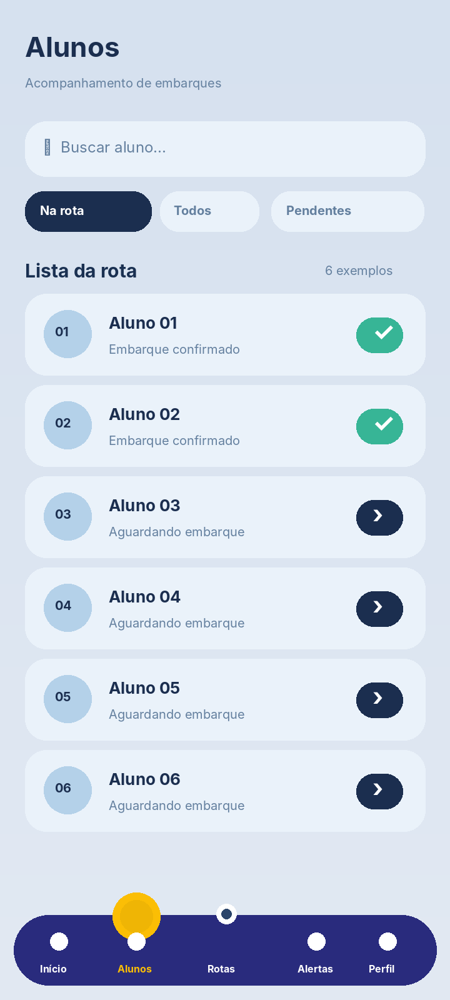
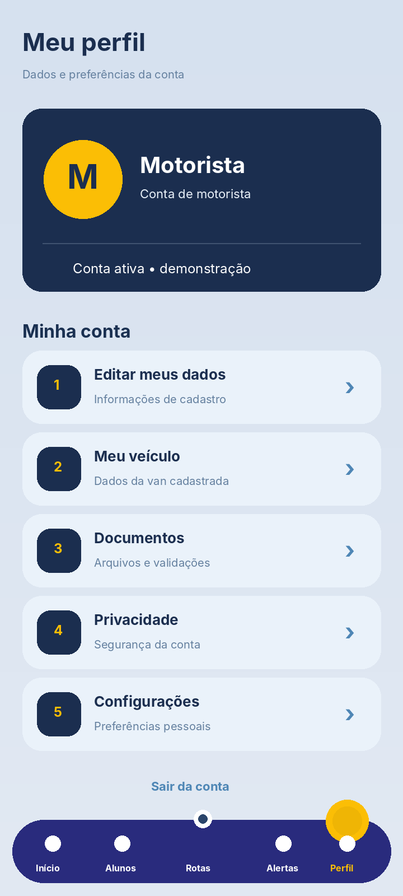

# Daily — 11/11/2026 | Evolução do Figma

**Projeto:** Lumio — Projeto Integrador  
**Data dos avanços:** 11/11/2026  
**Registro anterior:** 04/11/2026  
**Figma:** [Projeto Integrador](https://www.figma.com/design/YklZ8NiIhgwh6Qd1facwef/Projeto-Integrador?node-id=3-3)  
**Repositório:** [TIPI02-PI/PI-GRUPO2](https://github.com/TIPI02-PI/PI-GRUPO2)  
**Branch destinada à documentação:** `Igor`

O Figma está organizado em **cinco páginas**: **Prototipo** (base de telas e componentes), **Design System** (identidade visual e protótipos mobile), **Desktop** (painel web), **Fluxo** (navegação) e **Teste** (evolução das telas do motorista).

> **Escopo deste diário:** registrar o que foi desenhado no Figma. As interfaces são protótipos editáveis; mapas, botões, filtros, registros e números exibidos ainda não comprovam integração funcional com o sistema.

---

## ✅ Já desenhado — base inicial (registro de 04/11)

### Telas de entrada (mobile)

| Tela | O que tem |
|---|---|
| Splash Screen | Logo Lumio e o slogan **“Acompanhando cada trajeto”** |
| Welcome Screen | Logo, slogan e botões **Entrar** e **Cadastrar-se** |
| Login | E-mail e senha, opção de mostrar senha, botão Entrar, opção **Continuar com Google** e link para criar conta |
| Cadastro — passo 1/3 | Nome completo, e-mail, CPF ou CNPJ, botão Cadastrar e opção com Google |
| Cadastro — passo 2/3 | CEP, logradouro, número, complemento (opcional), bairro, cidade e estado |
| Cadastro — passo 3/3 | Criar e confirmar senha |

Essas telas pertencem ao esboço inicial e permanecem documentadas aqui para preservar o histórico do projeto.

### Design System e identidade visual

- Paleta de cores organizada em ações e destaques, textos principais, azul institucional, azul secundário, superfícies claras, campos e contrastes.
- Logo do Lumio.
- Componente **Bottom Bar** com variações por perfil (motorista, responsável, auxiliar e administração).
- Uso de azul-escuro, amarelo e da tipografia **Nunito** nas interfaces do motorista desenvolvidas depois.

### Fluxo do aplicativo

A página **Fluxo** apresenta a navegação prevista para os perfis **Responsável, Motorista, Auxiliar e Administrador**. O esboço contempla entrada e recuperação de acesso, áreas específicas por perfil e regras gerais, como notificações, troca de perfil e permissões.

---

## ✅ Avanços de 11/11/2026 — aplicativo mobile do motorista

A página **Teste** passou a concentrar as versões trabalhadas da interface mobile, com frames de **360 × 800 px**. A Home originalmente criada no Design System foi utilizada como referência e **preservada**, enquanto as telas na página Teste foram refinadas.

### Home do motorista

A Home passou a apresentar:

- saudação e acesso a notificações;
- card **Próxima rota**, com turno, horário e resumo do trajeto;
- botão de início da rota;
- prévia ilustrativa de mapa;
- acessos rápidos para **Meu veículo**, **Documentos**, **Suporte** e **Histórico**;
- barra inferior de navegação, com destaque para **Início**.

[Abrir Home no Figma](https://www.figma.com/design/YklZ8NiIhgwh6Qd1facwef/Projeto-Integrador?node-id=176-736)



### Telas adicionais desenvolvidas

| Tela | Conteúdo principal | Link no Figma |
|---|---|---|
| **Minhas rotas** | Programação semanal, turnos e resumo da próxima rota | [Abrir](https://www.figma.com/design/YklZ8NiIhgwh6Qd1facwef/Projeto-Integrador?node-id=184-25) |
| **Rota escolar em operação** | Itinerário escolar, paradas numeradas, indicadores de turno e registro de parada | [Abrir](https://www.figma.com/design/YklZ8NiIhgwh6Qd1facwef/Projeto-Integrador?node-id=184-180) |
| **Alunos** | Pesquisa, lista da rota e estados ilustrativos de embarque | [Abrir](https://www.figma.com/design/YklZ8NiIhgwh6Qd1facwef/Projeto-Integrador?node-id=184-318) |
| **Alertas** | Comunicados e atualizações da operação | [Abrir](https://www.figma.com/design/YklZ8NiIhgwh6Qd1facwef/Projeto-Integrador?node-id=184-479) |
| **Meu perfil** | Identificação, conta, preferências e acesso às configurações | [Abrir](https://www.figma.com/design/YklZ8NiIhgwh6Qd1facwef/Projeto-Integrador?node-id=184-620) |
| **Meu veículo** | Dados cadastrais e identificação da van | [Abrir](https://www.figma.com/design/YklZ8NiIhgwh6Qd1facwef/Projeto-Integrador?node-id=184-772) |
| **Documentos** | Envio, consulta e situação documental ilustrativa | [Abrir](https://www.figma.com/design/YklZ8NiIhgwh6Qd1facwef/Projeto-Integrador?node-id=184-902) |
| **Suporte** | Dúvidas frequentes e abertura de solicitações | [Abrir](https://www.figma.com/design/YklZ8NiIhgwh6Qd1facwef/Projeto-Integrador?node-id=184-1045) |
| **Histórico** | Consulta de viagens e estados sem registros | [Abrir](https://www.figma.com/design/YklZ8NiIhgwh6Qd1facwef/Projeto-Integrador?node-id=184-1187) |

### Mudanças na tela de rota em andamento

O design da tela de percurso recebeu várias revisões a partir do feedback de que ela **parecia um aplicativo de corridas**. A versão mais recente foi adaptada para um **painel de operação escolar**:

1. Cabeçalho com **Lumio / Transporte Escolar**, nome da rota, escola, turno e situação da operação.
2. Indicadores compactos com quantidade prevista de alunos, número de paradas e etapa atual.
3. Mapa **esquemático e ilustrativo** dentro de um painel identificado como *Itinerário escolar*, com traçado discreto e paradas numeradas.
4. Identificação visual da van e da escola, reforçando o contexto do transporte escolar.
5. Área inferior integrada à tela com **próxima parada** e ação de **Registrar**, sem painel flutuante gigante nem barra inferior com várias opções.
6. Orientação de segurança: o registro de parada deve ocorrer **somente com o veículo parado**.

**Observação:** os pontos do mapa, os valores numéricos, os horários e os nomes de escola são exemplos de apresentação. Não há GPS ou atualização em tempo real implementados por essa etapa de design.



### Outras prévias visuais







> **Sobre as imagens:** as cinco prévias acima são **ilustrações recriadas com base nas telas trabalhadas**, e não exportações oficiais dos frames. Para consultar as telas originais e suas camadas editáveis, use os links do Figma.

---

## ✅ Avanços de 11/11/2026 — área administrativa desktop

Na página **Desktop**, além do esboço inicial de planejamento de rotas, foi criada e organizada uma proposta de **interface administrativa**:

- login administrativo;
- dashboard/visão geral com indicadores e fila de análise;
- telas de **Usuários**, **Motoristas e vans**, **Documentos**, **Denúncias**, **Suporte** e **Configurações**;
- menu lateral e linguagem visual consistente entre os protótipos.

Os frames administrativos foram agrupados em um workspace para facilitar a visualização. As versões anteriores foram preservadas como histórico quando aplicável.

- [Workspace — telas administrativas organizadas](https://www.figma.com/design/YklZ8NiIhgwh6Qd1facwef/Projeto-Integrador?node-id=168-14)
- [Dashboard — visão geral](https://www.figma.com/design/YklZ8NiIhgwh6Qd1facwef/Projeto-Integrador?node-id=167-14)

**Atenção:** tabelas, métricas e registros exibidos no desktop são apenas exemplos de interface, não dados do banco.

---

## 🚧 Em andamento

| Área | Situação atual |
|---|---|
| **Motorista — mobile** | Home e nove telas adicionais desenhadas na página **Teste**; falta validação do fluxo e prototipação interativa |
| **Auxiliar — mobile** | Base da tela inicial existente; conteúdo específico ainda precisa ser desenvolvido e validado |
| **Responsável — mobile** | Base da tela inicial existente; conteúdo específico ainda precisa ser desenvolvido e validado |
| **Administração — mobile** | Base de navegação registrada no design inicial; escopo mobile a validar com a equipe |
| **Administração — desktop** | Login, visão geral e telas gerenciais prototipadas; faltam fluxos funcionais e integração |
| **Fluxo geral** | Mapa de navegação previsto no Figma; falta ligar e testar as transições |

---

## 🔜 Próximos passos

- [ ] Validar o escopo do motorista, das vans, dos alunos e dos responsáveis com o grupo.
- [ ] Revisar a usabilidade da tela de rota escolar, especialmente para reduzir distrações durante a condução.
- [ ] Criar ligações entre telas e testar os fluxos no **Prototype** do Figma.
- [ ] Refinar as interfaces mobile de **Auxiliar** e **Responsável**.
- [ ] Revisar os fluxos administrativos desktop com dados e permissões adequados.
- [ ] Substituir prévias ilustrativas por exportações oficiais do Figma, se necessário.
- [ ] Implementar componentes no projeto e integrar API, localização, autorizações e dados reais após revisão técnica.

---

## 📁 Organização dos arquivos para o GitHub

Ao publicar este diário, mantenha o arquivo Markdown na mesma pasta que **`imagens/`**, para que as prévias acima apareçam corretamente:

```text
figma/
├── figma.md
└── imagens/
    ├── home-motorista.png
    ├── minhas-rotas.png
    ├── rota-escolar-em-operacao.png
    ├── alunos.png
    └── perfil.png
```

**Destino recomendado:** branch `Igor` do repositório `TIPI02-PI/PI-GRUPO2`. Este arquivo documenta o design e **não** representa um commit já enviado.
